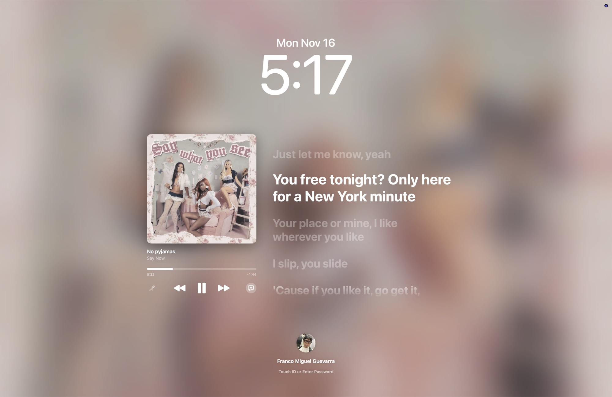
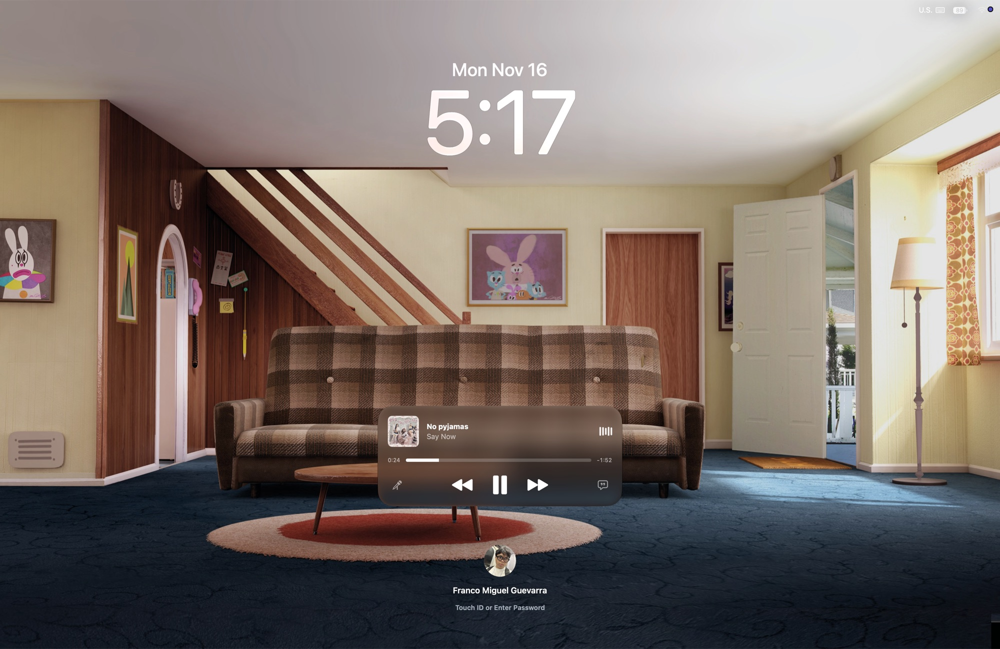
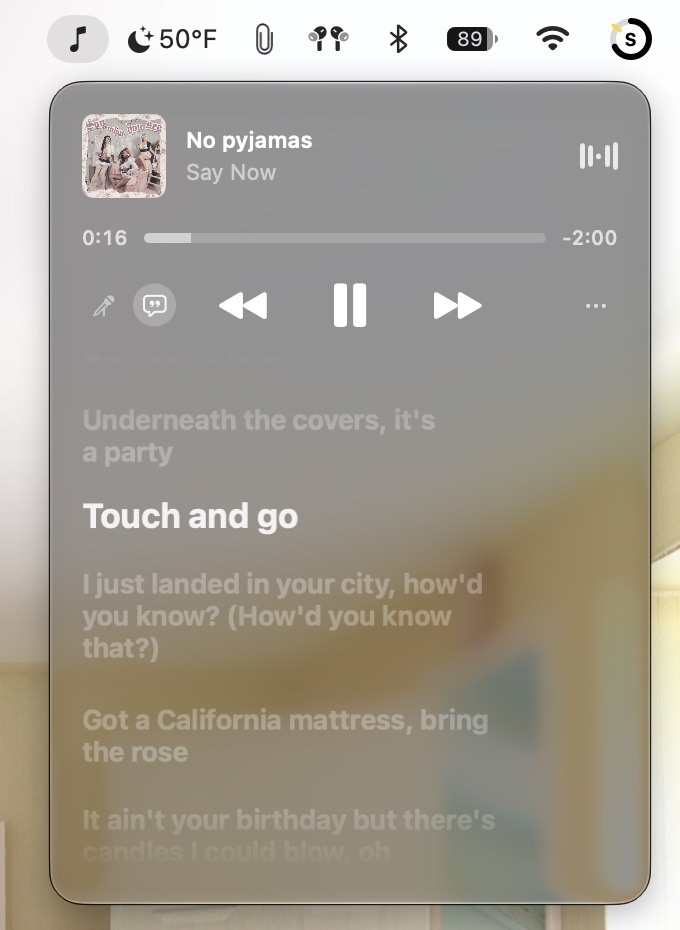

# Refrain

A now playing screen for the macOS lock screen, with synced lyrics and a menu bar player.

Refrain doesn't play music itself. It shows and controls whatever is already playing on your Mac: Apple Music, Spotify, or a music site in your browser.



## Features

- **Lock screen player.** When your Mac locks while music is playing, the lock screen shows the song's artwork, playback controls and synced lyrics. The clock and login prompt are redrawn around it.
- **Synced lyrics.** Lyrics follow the song line by line, each line settling a moment after the one above. Click a line to jump to it, or drag the progress bar to scroll through them. Songs without lyrics get a bigger, centred player.
- **Stays out of your way.** Start typing your password and the player shrinks to a small miniplayer so the password field shows.
- **Karaoke.** Removes the vocals from the playing app, like Apple Music Sing.
- **Reacts to the music.** A live waveform, and a background that pulses with the drums.
- **Menu bar player.** A compact player in the menu bar, with lyrics that open between the song and the controls.
- **Player window.** The full player in its own window, which can go full screen. It fits itself to the window's size and turns into a vertical layout, like Music on iPhone, when the window is tall.
- **Readable on any cover.** The background is deepened behind bright artwork and lifted behind dark artwork, in the artwork's own colours, so text stays readable and the cover stands out.
- **Music only.** It only takes over the lock screen for music apps and music websites, not videos or podcasts.

When you start typing your password, the player steps aside into a miniplayer:



The menu bar player, with lyrics open:



## Usage

1. Build the app (see below), move `Refrain.app` to `/Applications` and open it.
2. Allow **System Audio Recording** when asked. It's used for the waveform, the background pulse and karaoke. Audio is analysed live and never recorded.
3. Play some music, then lock your Mac (Control-Command-Q).

A music note appears in the menu bar. Click it for the player, and click the expand button next to **⋯** to open the player window. To quit, click **⋯** and choose **Quit Refrain**.

Refrain opens at login. You can turn that off in **System Settings > General > Login Items**.

For browser playback, macOS asks once per browser whether Refrain may control it. It only reads tab titles and addresses, to tell a music site from a video.

**Supported apps:** Apple Music, Spotify, Spotifast, Sonora, TIDAL, Amazon Music, Deezer, YouTube Music Desktop, VOX, Doppler and Swinsian. Also Safari and Chromium-based browsers (Chrome, Edge, Brave, Arc, Vivaldi) on Apple Music, Spotify, YouTube Music, SoundCloud, TIDAL, Deezer, Amazon Music, Bandcamp, Pandora, Qobuz, Audiomack and Mixcloud.

### Building

Requires macOS 26 and Xcode 26.

```sh
git clone https://github.com/frncg/Refrain.git
cd Refrain
xcodebuild -project Refrain.xcodeproj -scheme Refrain -destination 'platform=macOS' -configuration Release build
```

Or open `Refrain.xcodeproj` and run the `Refrain` scheme.

Builds are signed to run locally by default, so no developer account is needed. macOS asks for permissions again after each rebuild, though. To sign with your own team, copy `Local.xcconfig.example` to `Local.xcconfig` and add your Team ID.

## How it works

- **SwiftUI** for every screen. Each piece of the player (artwork, scrub bar, controls, lyrics) is shared between the lock screen, the player window and the menu bar.
- **Now Playing** comes from Apple's private MediaRemote framework, through [mediaremote-adapter](https://github.com/ejbills/mediaremote-adapter).
- **Drawing over the lock screen** uses private SkyLight APIs, through [SkyLightWindow](https://github.com/Lakr233/SkyLightWindow). macOS draws the wallpaper, clock and login prompt as one window, so nothing can sit between them. Refrain covers the whole lock screen and redraws the clock and prompt itself. It never draws a password field, and typing always goes to the real one.
- **Lyrics** come from [LRCLIB](https://lrclib.net), cleaned of credit and ad lines.
- **Audio levels** come from a Core Audio process tap of system output, analysed with an FFT (Accelerate). The background pulse follows whichever drum keeps the steadiest beat.
- **Karaoke** taps the music app's audio and isolates the vocals with Apple's AUSoundIsolation audio unit, then subtracts them from the song.
- **Browser detection** asks Safari or Chromium browsers for their open tabs over AppleScript.

Because it relies on private APIs, Refrain can't be sandboxed or sold on the Mac App Store, and a macOS update could break it.

## License

[MIT](LICENSE). Uses [mediaremote-adapter](https://github.com/ejbills/mediaremote-adapter) (BSD 3-Clause) and [SkyLightWindow](https://github.com/Lakr233/SkyLightWindow) (MIT).
